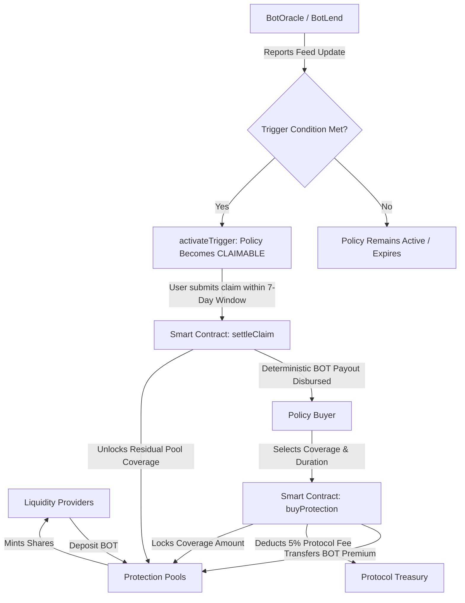

# BotInsure — Decentralized Parametric Protection Protocol

BotInsure is an on-chain, code-enforced parametric protection protocol built for the **Botchain** ecosystem (Chain ID `968`). It eliminates manual claims adjusters, arbitrary committee disputes, and subjective claim denials by relying strictly on verifiable on-chain oracle feeds and lending positions.

---

## 1. Executive Summary & Core Concept

In traditional DeFi insurance and discretionary mutuals, claim payouts often depend on subjective governance voting or centralized claims adjusters. 

**BotInsure adopts a purely parametric model**:
- Every policy has an explicit, measurable, mathematically verifiable trigger condition.
- When an on-chain oracle reports that a pre-defined threshold has been reached (e.g. BOT token price drops to $\le \$0.70$, or a BotLend collateral health factor drops below $1.0$), the policy automatically becomes claimable.
- Payouts are deterministic and strictly enforced by smart contracts.
- Liquidity providers supply underwriting capital in BOT tokens and earn variable yields from policy premiums.

---

## 2. Protection Products (MVP)

BotInsure launches with two foundational protection products:

### Product 1: BOT Price Drop Protection
- **Purpose**: Protects ecosystem participants against acute downside drops in BOT token valuation.
- **Trigger Type**: `TriggerType.PRICE_BELOW`
- **Data Source**: `IBotOracle` Feed #1 (BOT/USD, 8 decimals).
- **Trigger Rule**: Activated if `latestPrice <= triggerValue` (e.g., BOT price $\le \$0.70$).
- **Payout**: Deterministic (100% of coverage amount) disbursed directly to the policyholder.
- **Underwriting Pool**: Pool #1 (`BOT Price Protection Pool`).

### Product 2: BotLend Liquidation Protection
- **Purpose**: Protects leveraged borrowers on BotLend against liquidation events caused by collateral distress.
- **Trigger Type**: `TriggerType.HEALTH_FACTOR_BELOW`
- **Data Source**: `IBotLend` Position Reader.
- **Trigger Rule**: Activated if borrower's health factor $< 1.0\times 10^{18}$ ($1.00$).
- **Payout**: Deterministic (85% of coverage amount).
- **Underwriting Pool**: Pool #2 (`BotLend Liquidation Protection Pool`).

---

## 3. Parametric Protection Lifecycle



---

## 4. Underwriting & Liquidity Architecture

### Liquidity Pools & ERC20 Share Tokens
- Each protection pool manages its capital in BOT tokens and issues an OpenZeppelin-governed ERC20 share token (`BotInsurePoolToken`).
- Initial deposit: 1 share = 1 BOT.
- Subsequent deposits:
  $$\text{sharesToMint} = \frac{\text{depositAmount} \times \text{totalShares}}{\text{poolNetAssets}}$$
- Withdrawals:
  $$\text{botAmount} = \frac{\text{sharesBurned} \times \text{poolNetAssets}}{\text{totalShares}}$$
- **Capital Solvency Lock**: The protocol strictly prevents liquidity providers from withdrawing funds required to back active policy coverage obligations (`poolNetAssets - withdrawAmount >= lockedCoverage`).

### Transparent Premium Pricing Model
Premiums are calculated on-chain using transparent fixed-point arithmetic:
$$\text{Premium} = \frac{\text{coverageAmount} \times \text{premiumRate} \times \text{duration}}{10000 \times 365\text{ days}}$$

- **Protocol Fee**: 5% of paid premiums is allocated to protocol reserves/treasury.
- **Pool Underwriting Yield**: 95% of paid premiums is deposited directly into pool assets, increasing the redeemable value of each LP pool share.
- **Variable Yield Notice**: *Returns are variable and depend on premiums, claims, fees, and pool performance. No guaranteed APY is promised.*

---

## 5. Security & Risk Engineering

BotInsure contracts incorporate production-grade security patterns:
- **Checks-Effects-Interactions**: State transitions precede all token transfers.
- **OpenZeppelin ReentrancyGuard**: Applied to `provideLiquidity`, `withdrawLiquidity`, `buyProtection`, and `settleClaim`.
- **OpenZeppelin SafeERC20**: Safe token transfers for all standard and non-standard ERC20 operations.
- **OpenZeppelin AccessControl**: Granular role-based authorization (`PRODUCT_MANAGER_ROLE`, `POOL_MANAGER_ROLE`, `ORACLE_MANAGER_ROLE`, `PAUSER_ROLE`).
- **OpenZeppelin Pausable**: Emergency circuit-breaker that blocks new deposits and purchases while preserving claim settlement.
- **Oracle Freshness Verification**: Rejects stale reports (`block.timestamp - updatedAt > maxOracleAge`), negative prices, and zero values.
- **Duplicate Prevention**: Policies cannot be triggered twice or claimed twice.
- **Claim Window Expiration**: 7-day post-trigger claim window prevents indefinite capital lockup.

---

## 6. Project Directory Structure

```
Work 14/
├── contracts/
│   ├── core/
│   │   ├── BotInsure.sol               # Core Parametric Protocol
│   │   └── BotInsurePoolToken.sol      # ERC20 Pool Share Token
│   ├── interfaces/
│   │   ├── IBotInsure.sol              # Full protocol interface & structs
│   │   ├── IBotOracle.sol              # BotOracle price feed interface
│   │   └── IBotLend.sol                # BotLend interface
│   └── mocks/
│       ├── MockBOT.sol                 # Faucet-enabled BOT ERC20
│       ├── MockBotOracle.sol           # Configurable price feed mock
│       └── MockBotLend.sol             # Configurable health factor mock
├── test/
│   └── BotInsure.test.ts               # 35 comprehensive automated tests
├── scripts/
│   └── deploy.ts                       # Complete deployment script
├── frontend/                           # Next.js 14 Web3 application
│   ├── src/
│   │   ├── app/
│   │   │   ├── page.tsx                # / Dashboard
│   │   │   ├── products/page.tsx       # /products Catalog
│   │   │   ├── protect/[productId]/    # /protect/[productId] Purchase
│   │   │   ├── policies/page.tsx       # /policies User policies
│   │   │   ├── policy/[id]/            # /policy/[id] Detail & Settle
│   │   │   ├── pools/page.tsx          # /pools Pools overview
│   │   │   ├── pool/[id]/              # /pool/[id] Pool deposit/withdraw
│   │   │   ├── claims/page.tsx         # /claims Claims list
│   │   │   ├── claim/[id]/             # /claim/[id] Claim detail
│   │   │   ├── liquidity/page.tsx      # /liquidity LP dashboard
│   │   │   ├── admin/page.tsx          # /admin Governance & Simulator
│   │   │   └── developer/page.tsx      # /developer SDK & APIs
│   │   ├── components/                 # Navbar, Footer, Web3Provider
│   │   ├── config/                     # Chains, Contracts, ABIs, Wagmi
│   │   └── lib/                        # Identity, formatters
├── hardhat.config.ts                   # Hardhat config with Botchain Testnet
├── package.json                        # Monorepo scripts
└── README.md
```

---

## 7. Installation & Quickstart

### Prerequisites
- Node.js (v18+)
- npm (v9+)

### Installation
```bash
npm install
```

### Compile Smart Contracts
```bash
npx hardhat compile
# or
npm run compile
```

### Run Comprehensive Test Suite
```bash
npx hardhat test
# or
npm run test
```
*Executes all 35 tests covering deployment, pool share math, product limits, oracle freshness, BotLend triggers, double-claim prevention, pause behavior, and financial capping.*

---

## 8. Deployment

### Local Deployment
```bash
npm run deploy:local
```

### Botchain Testnet Deployment
Configure your deployer private key in `.env`:
```env
BOTCHAIN_RPC_URL=https://rpc.bohr.life
DEPLOYER_PRIVATE_KEY=your_private_key_here
```
Then execute:
```bash
npm run deploy:testnet
```

---

## 9. Autonomous Keeper Bot

BotInsure includes a decentralized off-chain Keeper Bot that monitors oracle feeds and collateral positions, autonomously triggering claim eligibility and cleaning up expired policies to release pool capacity:

### Run Single Sweep
```bash
npm run keeper
```

### Run Continuous Monitoring Daemon (every 15s)
```bash
npm run keeper:watch
```

---

## 10. Next.js Frontend dApp

### Run Development Server
```bash
npm run frontend
```
Opens the application at [http://localhost:3005](http://localhost:3005).

### Build for Production
```bash
npm run frontend:build
```

### Key Frontend Features:
- **Real On-Chain Data**: No fake statistics, fake transactions, or mock numbers. All values reflect live contract state.
- **Built-in Faucet**: 1-click testnet faucet directly in the navigation bar to claim 1,000 BOT test tokens.
- **Dual Network Support**: Seamlessly connects to Botchain Testnet (Chain ID `968`) or Localhost (Chain ID `31337`).
- **Interactive Trigger Simulator**: Located in `/admin`, allowing developers and testers to set the BOT price (e.g., $0.65) or BotLend health factor (e.g., 0.85) to trigger policies on-demand.

---

## 11. Botchain Testnet Configuration

| Parameter | Value |
| :--- | :--- |
| **Network Name** | Botchain Testnet |
| **Chain ID** | `968` |
| **RPC Endpoint** | `https://rpc.bohr.life` |
| **Block Explorer** | [https://scan.bohr.life](https://scan.bohr.life) |
| **Native Gas Token** | `BOT` |

---

## 12. Important Protocol Limitations & Disclaimers

1. **MVP Status**: BotInsure is an experimental proof-of-concept for the Botchain hackathon and ecosystem development. It has not been formally audited.
2. **Not Regulated Insurance**: BotInsure does not offer regulated commercial insurance products. It is a decentralized, code-driven parametric guarantee protocol.
3. **Oracle Dependency**: Payouts depend on timely and honest price feed updates from `IBotOracle` and `IBotLend`. Outages or invalid oracle updates can halt claim settlements.
4. **Underwriting Capital Risk**: Liquidity providers may lose part or all of their deposited principal if claim payouts in a given pool exceed premiums collected.

---

## 13. Future Roadmap

- [ ] Multi-collateral underwriting pools (BOT, USDC, USDT)
- [ ] Integration with decentralized chainlink-compatible keeper networks for autonomous trigger execution
- [ ] Full BotNS resolution (`alice.bot`, `protocol.bot`)
- [ ] Cross-chain parametric coverage across EVM networks
- [ ] Secondary marketplace for tokenized protection policies (ERC-721 / ERC-1155)
