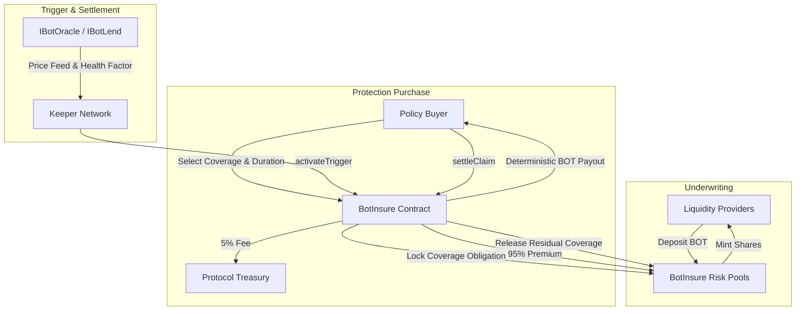

# BotInsure Protocol — Whitepaper & Pitch Deck
**"Deterministic, Zero-Dispute Parametric Protection for the Botchain Ecosystem"**

*On-Chain Code-Enforced Parametric Protection Protocol Built on Botchain Testnet (Chain ID: 968)*

---

## Executive Summary

Decentralized Finance (DeFi) has unlocked unprecedented capital velocity and composability, yet it remains exposed to severe systemic vulnerabilities: sudden token crashes, rapid liquidation spirals, and oracle latency. Traditional mutuals and discretionary Web3 insurance models have failed to provide reliable safety nets because they depend on subjective claims assessment, centralized claims adjusters, or sluggish governance voting that routinely denies valid claims or locks capital in endless dispute arbitration.

**BotInsure** introduces an on-chain, code-enforced **parametric protection protocol** purpose-built for the **Botchain ecosystem (Chain ID 968)**. BotInsure replaces human discretion with mathematical certainty:
- **Binary & Measurable Triggers**: Protection policies are tied strictly to verifiable, deterministic on-chain data sources—including `IBotOracle` price feeds and `IBotLend` borrower health factor positions.
- **Instantaneous Settlements**: When a trigger threshold is breached (e.g., BOT token drops to $\le \$0.70$ or a loan health factor falls $< 1.00$), the policy automatically enters a claimable state without governance delays or adjuster approvals.
- **Yield-Bearing Liquidity Underwriting**: Capital providers deposit BOT tokens into dedicated risk pools to back coverage, earning 95% of policy premiums via yield-accruing ERC-20 share tokens (`BotInsurePoolToken`) with automated capital solvency safeguards.
- **Decentralized Keeper Network**: Autonomous keeper bots continually evaluate oracle conditions, triggering claim windows and unlocking expired capacity permissionlessly.

---

## 1. Problem Statement & Market Opportunity

### The Dilemma of Discretionary Web3 Insurance
Current Web3 coverage protocols face critical architectural flaws:
1. **Subjective Claim Denials**: Claims are evaluated post-incident by DAO token-holder votes or closed assessment committees. Token holders have a direct financial conflict of interest to vote against payouts to protect their treasury capital.
2. **Protracted Settlement Cycles**: Claim evaluations frequently drag on for weeks or months while claimants suffer irreversible financial liquidations.
3. **Capital Inefficiency**: Underwriting capital is often locked in monolithic pools with opaque risk profiles and complex governance overhead.
4. **Lack of Ecosystem Integration**: Existing protocols operate as isolated dApps rather than integrating natively with lending protocols, DEXs, and native oracles.

### The Parametric Solution
Parametric protection resolves this conflict completely:
* Pre-agreed, mathematically verifiable trigger parameters.
* Transparent, immutable smart contract logic.
* Guaranteed deterministic payouts executed immediately upon trigger verification.

---

## 2. Core Protocol Architecture

BotInsure operates through a modular, non-custodial architecture deployed on Botchain:

### Protocol Components
1. **`BotInsure.sol`**: The core singleton protocol contract managing policy issuance, premium calculation, trigger verification, and claim disbursements.
2. **`BotInsurePoolToken.sol`**: ERC-20 compliant pool share tokens representing pro-rata ownership of underwriting reserves.
3. **`IBotOracle` & `IBotLend` Adapters**: Decentralized oracle and position readers providing tamper-resistant inputs for automated condition evaluation.
4. **Autonomous Keepers**: Off-chain daemons continuously monitoring live feeds, executing trigger transactions, and recycling expired coverage.

---

## 3. Protection Products (MVP)

BotInsure launches with two foundational protection products engineered for Botchain participants:

### Product 1: BOT Token Price Drop Protection
* **Target Audience**: BOT token holders, staking participants, and ecosystem builders looking to hedge acute market drawdowns.
* **Trigger Type**: `TriggerType.PRICE_BELOW`
* **Data Source**: `IBotOracle` Feed #1 (BOT/USD, 8 decimals)
* **Trigger Condition**: Activated if `latestPrice <= triggerValue` (e.g., BOT $\le \$0.70$)
* **Payout**: **100%** of purchased coverage amount in BOT tokens
* **Underwriting Pool**: Pool #1 (`BOT Price Protection Pool`)

### Product 2: BotLend Liquidation Protection
* **Target Audience**: Borrowers and leverage traders on BotLend seeking an automated hedge against volatile collateral liquidation.
* **Trigger Type**: `TriggerType.HEALTH_FACTOR_BELOW`
* **Data Source**: `IBotLend` Position Reader
* **Trigger Condition**: Activated if borrower collateral Health Factor drops below $1.0\times 10^{18}$ ($1.00$)
* **Payout**: **85%** of purchased coverage amount in BOT tokens
* **Underwriting Pool**: Pool #2 (`BotLend Liquidation Protection Pool`)

---

## 4. Financial Engineering & Underwriting Economics

### Actuarial Premium Calculation
Premiums are calculated dynamically on-chain using transparent fixed-point arithmetic based on duration and coverage capacity:

$$\text{Premium} = \frac{\text{coverageAmount} \times \text{premiumRate} \times \text{duration}}{10000 \times 365\text{ days}}$$

* **Premium Distribution**:
  * **95%** credited directly to the underwriting liquidity pool, increasing the redeemable value of LP shares.
  * **5%** allocated to the Protocol Treasury for ongoing protocol maintenance and developer grants.

### Liquidity Pool Share Dynamics
Underwriting pools issue shares based on the constant net asset value formula:
* **Initial Deposit**: $1\text{ Share} = 1\text{ BOT}$
* **Subsequent Deposits**:
  $$\text{Shares Minted} = \frac{\text{depositAmount} \times \text{totalShares}}{\text{poolNetAssets}}$$
* **Withdrawals**:
  $$\text{BOT Redeemed} = \frac{\text{sharesBurned} \times \text{poolNetAssets}}{\text{totalShares}}$$
* **Solvency Protection Lock**: LPs cannot withdraw funds that are actively backing active policy obligations ($\text{poolNetAssets} - \text{withdrawAmount} \ge \text{lockedCoverage}$).

---

## 5. Security Architecture & Risk Mitigations

BotInsure adheres to institutional smart contract safety standards:
1. **Checks-Effects-Interactions (CEI)**: State transitions strictly precede external token transfers.
2. **Reentrancy Protection**: OpenZeppelin's `ReentrancyGuard` secures all critical deposit, withdrawal, purchase, and settlement functions.
3. **Safe Token Transfers**: `SafeERC20` handles all token interactions safely.
4. **Oracle Staleness Guards**: Smart contracts reject price feed updates older than `maxOracleAge` (e.g., 3600 seconds) or non-positive price values.
5. **Double-Claim Guards**: Policies are strictly single-use and transition to `Claimed` upon payout settlement.
6. **7-Day Claim Expiration Window**: Post-trigger claim windows ensure dormant claims do not permanently paralyze pool liquidity.
7. **Circuit Breakers (`Pausable`)**: Role-governed emergency pause mechanism stops new purchases while preserving valid claim settlements.

---

## 6. Live Testnet Deployment & Verification

| Network Parameter | Deployed Configuration |
| :--- | :--- |
| **Network** | Botchain Testnet |
| **Chain ID** | `968` |
| **RPC Endpoint** | `https://rpc.bohr.life` |
| **Block Explorer** | [https://scan.bohr.life](https://scan.bohr.life) |
| **BotInsure Contract** | `0xdc04788364d51f8A836794694a728322634bD4Ac` |
| **BOT Test Token** | `0xa745cA6705B718156207a29cb102d7EA1Cd27720` |
| **BotOracle Feed** | `0x79bEA635f37aCeE4AfFa8056474180921F156cea` |
| **BotLend Contract** | `0x11148C246EBcfCE2E189d24044178072F3C8f2b6` |

---

## 7. Roadmap & Future Expansion

- **Phase 1 (Completed)**: Core contracts, 35 comprehensive automated tests, Botchain Testnet deployment, autonomous keeper daemon, interactive dApp with live faucet and trigger simulator.
- **Phase 2 (Q2 2026)**: Multi-asset collateral pools (BOT, USDC, USDT), secondary policy trading (ERC-721 tokenized coverage), integration with native BotNS naming.
- **Phase 3 (Q3 2026)**: Cross-chain parametric coverage bridging EVM ecosystems and decentralized keeper oracle consensus networks.

---

## 8. Disclaimers

BotInsure is a decentralized, code-enforced parametric protocol developed for the Botchain ecosystem. It does not provide regulated commercial insurance policies. Liquidity underwriting involves market risks; returns are variable and dependent on aggregate claim settlements and pool performance.
